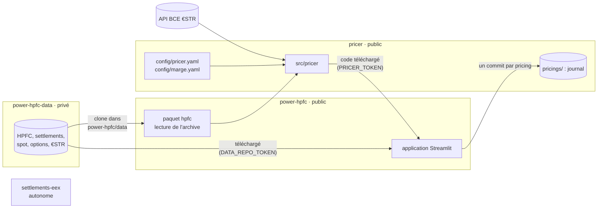

# Notice détaillée — pricer

Cette notice décrit **chaque élément calculé par le pricer, comment il l'est, et tout ce qui entre dans les
calculs** : données, paramètres, formules, règles de choix, contrôles et avertissements. Les noms de fichiers,
de fonctions et de paramètres sont ceux du code (`src/pricer/`, `config/`).

Sommaire

1. [Place du pricer parmi les trois dépôts](#1-place-du-pricer-parmi-les-trois-dépôts)
2. [Données de marché utilisées](#2-données-de-marché-utilisées)
3. [Produits : décrire un deal](#3-produits--décrire-un-deal)
4. [Prix fixe : vue d'ensemble](#4-prix-fixe--vue-densemble)
5. [Couverture EEX et résidu day-ahead](#5-couverture-eex-et-résidu-day-ahead)
6. [Prix juste](#6-prix-juste)
7. [Coût de risque du résidu (risque de forme)](#7-coût-de-risque-du-résidu-risque-de-forme)
8. [Prime de niveau day-ahead (risque de niveau)](#8-prime-de-niveau-day-ahead-risque-de-niveau)
9. [Facturation du risque : quantile ou coût du capital](#9-facturation-du-risque--quantile-ou-coût-du-capital)
10. [Frais, conversion et liquidité](#10-frais-conversion-et-liquidité)
11. [Financement](#11-financement)
12. [Marge](#12-marge)
13. [Choix du scénario et prix proposé](#13-choix-du-scénario-et-prix-proposé)
14. [Exposition au spot et grilles de couverture](#14-exposition-au-spot-et-grilles-de-couverture)
15. [Contrat indexé spot : « EPEX spot ± spread »](#15-contrat-indexé-spot--epex-spot--spread-)
16. [Options EEX : call, put, collar](#16-options-eex--call-put-collar)
17. [Avertissements affichés](#17-avertissements-affichés)
18. [Journal et archives des pricings](#18-journal-et-archives-des-pricings)
19. [Autres outils : valorisation, TBx, batterie](#19-autres-outils--valorisation-tbx-batterie)
20. [Tous les paramètres](#20-tous-les-paramètres)
21. [Organisation du code et tests](#21-organisation-du-code-et-tests)

Convention de signe utilisée partout : **MW > 0 = on achète** l'électricité (achat à une contrepartie, par
exemple un producteur) ; **MW < 0 = on la vend** (vente au client). Les prix sont en €/MWh, les montants en €.

---

## 1. Place du pricer parmi les trois dépôts

- **Ce que le pricer prend dans power-hpfc.** `Market.load(chemin du clone power-hpfc)` importe le paquet
  `hpfc` installé depuis ce clone (`pip install -e`). Il vérifie que c'est bien le même dossier, puis lit dans
  `power-hpfc/data/`, qui est un clone du dépôt privé `menckley/power-hpfc-data` :
  - la **HPFC** de la dernière séance (ou d'une date donnée) et ses métadonnées ;
  - les **settlements EEX** de cette séance ;
  - l'historique **spot day-ahead** ENTSO-E ;
  - toutes les **séances de futures** archivées ;
  - les **settlements d'options** EEX ;
  - le **journal €STR**.

  La définition du peak et la tolérance de reproduction viennent de `power-hpfc/config/FR.yaml`. Le pricer ne
  télécharge lui-même que l'€STR (API BCE). Avec `sync=True`, `Market.load` fait d'abord un `git pull --ff-only` du
  clone power-hpfc et du clone de données, et refuse si `data/` a été modifié localement (`market.sync_repo`).
- **Dans l'application en ligne**, `data/` est l'archive du dépôt de données téléchargée par l'application
  (`power-hpfc/app/data_sync.py`) : le pricer le lit de la même façon.
- **Qui l'utilise.** L'application de power-hpfc télécharge le code de ce dépôt (secret `PRICER_TOKEN`) et écrit
  chaque pricing enregistré dans `pricings/` par l'API GitHub. En local, le notebook `notebooks/pricer.ipynb`
  utilise le formulaire `pricer.ui`.
- **settlements-eex** n'a aucun lien avec le pricer.

---

## 2. Données de marché utilisées

`src/pricer/market.py`, classe `Market`.

| Donnée | Usage | Contrôle au chargement |
|---|---|---|
| **HPFC** horaire (`price`, `is_peak`, index UTC) | prix juste, valeur du résidu, prime de forme, niveau forward | pas horaire continu, aucun prix manquant ; nombre d'heures = métadonnées |
| **Settlements EEX** de la séance | couverture et sa valeur, contrat coté, forward des options | **chaque produit recalculé sur la HPFC doit retomber sur son settlement à 0,01 €/MWh près** (`check_settlements`), sinon le pricing est refusé |
| **Spot day-ahead** ENTSO-E (`spot_loader`) | coût de risque du résidu, proxy de persistance | grille complète (contrôlée par power-hpfc) |
| **Séances de futures** (`history_loader`) | volatilité historique des futures | — |
| **Options EEX** (`options_loader`) | volatilité implicite, pricing d'options | contrôles de qualité à chaque pricing (§16) |
| **€STR** : API BCE, puis journal de power-hpfc (`estr_loader`) | financement | API : dernier €STR publié au plus 5 jours avant la date de pricing ; journal : dernier archivé, ancienneté signalée |

Grille : chaque heure a son jour local, son heure locale, son jour de semaine et son mois. **Peak** = heures 8 à
20 h, du lundi au vendredi (définition EEX). **Offpeak** = toutes les autres heures. La courbe va du lendemain
de la séance au 31 décembre de la dernière année cotée : une livraison hors de cette période est refusée.

---

## 3. Produits : décrire un deal

`src/pricer/products.py`. Un produit est une puissance signée heure par heure (`Product.mw`) sur la grille de
la HPFC, avec une définition compacte (`spec`) enregistrée dans le journal.

| Constructeur | Deal |
|---|---|
| `block(start, end, mw, side, profile)` | bloc Base, Peak ou Offpeak sur une période |
| `weekly(start, end, mw, grid, side)` | semaine type cochée (24 heures × 7 jours) appliquée à toute la période. Un jour férié suit son jour de semaine. Heure locale : la case 2 couvre 2h-3h, est livrée deux fois les jours de 25 h et pas du tout les jours de 23 h |
| `custom(mw, name)` | profil horaire libre (CSV : `horodatage` avec fuseau, `mw` signé) |
| `eex(contract, profile, mw, side)` | copie exacte d'un contrat EEX coté à la séance (ex. `Cal-27`, `Q1-27`, `M11-26`) |
| `as_swap(p)` | swap financier prix fixe contre spot sur le même profil (`physical=False`) : ni conversion financier → physique, ni financement |

Volume : $V = \sum_h |q_h|$ (MWh, pas horaire). Un produit qui mélange achats et ventes est refusé : il faut
coter chaque sens séparément, car un prix par MWh n'aurait pas de sens.

---

## 4. Prix fixe : vue d'ensemble

`src/pricer/quote.py`, fonction `quote`. Le prix proposé est :

$$\text{Prix proposé} = \text{Prix juste} \;\pm\; \frac{\text{Risque résiduel} + \text{Prime de niveau} + \text{Frais} + \text{Conversion} + \text{Liquidité} + \text{Lot incomplet} + \text{Financement} + \text{Marge}}{V}$$

Le signe est **+ pour une vente au client** (on lui facture nos coûts) et **− pour un achat** à une contrepartie
(on les déduit du prix payé).

Déroulement :

1. **Contrôles.** Le produit doit être sur la grille et dans un seul sens. Une marge manuelle exige un motif.
   Tous les paramètres nécessaires doivent être renseignés (`Settings.missing`, §20) : un paramètre vide
   arrête le pricing avec la liste des champs à remplir.
2. **Contrat coté ?** Si le produit est la copie exacte d'un contrat EEX coté (mêmes heures, MW constants,
   `listed_contract`), il se couvre par lui-même : aucun scénario, aucun résidu, aucune prime de niveau.
3. **Sinon, un scénario par stratégie de couverture** (§5), plus le scénario *Full day-ahead* si
   `deviation.full_day_ahead: true`. Pour chacun, on calcule la couverture, le prix juste, le risque résiduel, la
   prime de niveau, les frais, la conversion, la liquidité, le lot incomplet et la marge.
4. **Choix du scénario** (§13) : le moins cher en mode `auto`, ou celui demandé.
5. **Construction du prix**, ligne par ligne, avec ses avertissements.

Lignes de la construction du prix (`q.lines`), dans l'ordre :

| Ligne | § |
|---|---|
| EEX hedge at settlement | 5, 6 |
| Day-ahead residual at HPFC (shape premium) | 5, 6 |
| Settlement rounding | 6 |
| **= Fair price** | 6 |
| ± Residual risk cost (règle de facturation) | 7, 9 |
| ± Day-ahead level premium (méthode ; règle de facturation) | 8, 9 |
| ± EEX and day-ahead fees | 10 |
| ± Financial-to-physical conversion | 10 |
| ± Liquidity premium | 10 |
| ± Odd-lot premium (MWh hors lot entier de 1 MW) | 10 |
| ± Funding cost | 11 |
| ± Margin (règle) | 12 |
| **= Offer price** | 13 |

En *Full day-ahead*, les trois premières lignes sont remplacées par « Day-ahead sourcing at HPFC (no EEX
hedge) ».

---

## 5. Couverture EEX et résidu day-ahead

`src/pricer/hedging.py`.

**Notations.** Position du deal $q$. Couverture équivalente $h$, de même signe que $q$ : elle est traitée en
**sens inverse** sur EEX. Une vente au client se couvre en achetant sur EEX. Le résidu est $r = q - h$ :

- $r > 0$ : surplus d'énergie, **revendu** en day-ahead ;
- $r < 0$ : manque, **acheté** en day-ahead.

### 5.1 Découpage en produits cotés (`partition`)

Chaque année de la courbe est découpée de la façon la plus fine possible en produits cotés **à la fois en Base
et en Peak**, aux niveaux autorisés par la stratégie : mois, sinon trimestre, sinon année. Un trimestre n'est
remplacé par ses mois que si les trois mois sont cotés. Les heures sans produit coté, en pratique le mois en
cours, restent **non couvrables** : tout leur volume va en day-ahead.

### 5.2 Stratégies

Pour chaque produit $P$ du découpage, on note :
- $V_{pk}$ et $V_{op}$ : les MWh du deal sur ses heures peak et offpeak ;
- $H_{pk}$ et $H_{op}$ : le nombre de ces heures.

| Stratégie | Niveaux | Base MW | Peak MW |
|---|---|---|---|
| **Base+Peak monthly** | mois, trimestre, année | $V_{op}/H_{op}$ | $V_{pk}/H_{pk} - \text{Base}$ |
| **Base+Peak quarterly** | trimestre, année | $V_{op}/H_{op}$ | $V_{pk}/H_{pk} - \text{Base}$ |
| **Base only monthly** | mois, trimestre, année | $(V_{pk}+V_{op})/(H_{pk}+H_{op})$ | 0 |
| **Peak only + day-ahead** | mois, trimestre, année | 0 | $V_{pk}/H_{pk}$ |
| **Full day-ahead** | aucun | 0 | 0 |

- Un contrat Base livre **toutes** les heures, peak comprises. Le Peak est donc dimensionné **en complément du
  Base**. Avec Base+Peak, les MWh peak et offpeak de chaque produit sont reproduits exactement, et le résidu de
  chaque bloc est de volume nul. Il ne reste que la **forme** à l'intérieur des blocs.
- **Lecture Peak / Offpeak.** Base $b$ + Peak $p$ détenus ensemble équivalent à un Peak de $b + p$ sur les heures
  peak plus un Offpeak de $b$ sur les heures offpeak. L'Offpeak n'est pas coté sur EEX France : il est porté par
  le contrat Base.
- **Peak only.** Les heures peak sont couvertes. **Tout l'offpeak livré** reste en day-ahead, sans couverture de
  niveau : son risque de niveau est dans la prime de niveau (§8).
- **Full day-ahead.** Aucun contrat. Tout le volume est acheté ou revendu en day-ahead.
- **Contrat coté** (`listed_hedge`). Le contrat lui-même, 0 résidu.

Tableau de couverture (`h.table`), un contrat par ligne : début, fin, Base MW, Peak MW, settlements Base et
Peak, MWh Base et Peak, valeur de la couverture = Base MW × heures × settlement Base + Peak MW × heures peak ×
settlement Peak.

### 5.3 Synthèse de la couverture (`hedge_summary`)

| Clé | Calcul |
|---|---|
| curve value € | $\sum_h q_h \cdot \text{HPFC}_h$ |
| EEX hedge at settlement € | somme des valeurs de couverture aux settlements |
| residual at HPFC € | $\sum_h r_h \cdot \text{HPFC}_h$ |
| settlement rounding € | curve value − hedge − residual (la HPFC reproduit les settlements au centime près) |
| EEX hedged MWh | $\sum_h \lvert h_h \rvert$ |
| day-ahead surplus to sell MWh | $\sum_h \max(r_h, 0)$ |
| day-ahead shortfall to buy MWh | $\sum_h \max(-r_h, 0)$ |
| unhedgeable MWh | MWh du deal sur des heures sans produit coté |

---

## 6. Prix juste

$$\text{Prix juste} = \frac{\sum_h q_h \cdot \text{HPFC}_h}{\sum_h q_h}$$

C'est la moyenne de la HPFC pondérée par les volumes. Elle se décompose en :
- valeur de la couverture aux settlements ;
- valeur du résidu à la HPFC, que la ligne du prix appelle **prime de forme** ;
- arrondi des settlements.

Pour un **contrat coté**, le prix juste est **son settlement** : la valeur de la courbe est remplacée par la
valeur de la couverture.

---

## 7. Coût de risque du résidu (risque de forme)

`src/pricer/risk.py`, fonction `residual_risk`. Ce coût mesure le risque que le résidu, de volume nul par bloc,
coûte plus que prévu parce que la forme réalisée du spot diffère de celle de la HPFC.

**Historique utilisé.** Spot de `risque.historique_debut` (2019-01-01) jusqu'au dernier jour du dernier mois
complet avant la date de pricing. Toutes les années sont incluses, sans exclusion.

**Pour chaque mois livré $m$ :**

1. **Semaine type du résidu.** MW moyen du résidu par (jour de semaine, heure locale), soit 168 cellules. On
   divise par le nombre d'heures de la cellule dans le mois.
2. **Mois historiques comparables.** Même mois calendaire ± `risque.fenetre_mois` (1), sur tout l'historique.
3. **Rejeu sur chaque mois historique $y$.** La semaine type est appliquée heure par heure. Elle est
   **recentrée** pour avoir un volume nul sur chaque bloc couvert : Peak et Offpeak séparément si la stratégie
   a du Peak (Full day-ahead compris), Base seul pour *Base only*. Le niveau est ainsi exclu : seule la forme
   reste mesurée. Le résultat est valorisé au spot réalisé.
4. **Remise à l'échelle.** On divise par le prix spot moyen du mois historique, et on multiplie par le niveau
   forward du mois livré (moyenne de la HPFC sur le mois) :

$$\text{P\&L}_{m,y} = \frac{\sum_{h\in y} \tilde r_h \, S_h}{\bar S_y} \times \overline{\text{HPFC}}_m$$

5. $\sigma_m$ = écart-type de ces P&L. Il faut au moins 5 mois comparables, sinon erreur. Le tableau donne
   aussi la moyenne, le pire et le meilleur cas, et le nombre d'échantillons.

**Total.** On suppose une corrélation uniforme $\rho$ = `risque.correlation_mois` (0 = mois indépendants) :

$$\sigma^2 = \sum_m \sigma_m^2 + \rho\Big[\big(\textstyle\sum_m \sigma_m\big)^2 - \sum_m \sigma_m^2\Big]$$

$$\text{quantile} = z(\text{confiance}) \times \sigma \qquad (z = 1{,}645 \text{ à } 95\,\%)$$

Hypothèses : P&L de loi normale, corrélation uniforme. Le quantile est ensuite facturé selon le §9.

**Non mesuré.** Le risque de niveau d'un mois à l'intérieur d'un trimestre ou d'une année couverts en bloc. Il
faudrait un historique forward, qui n'existe pas gratuitement : un avertissement le rappelle (§17).

---

## 8. Prime de niveau day-ahead (risque de niveau)

`src/pricer/deviation.py`. Elle porte sur le **risque que le niveau du day-ahead réalisé s'écarte du forward**,
pour les MWh traités en day-ahead **sans couverture de niveau** (`level_open`) :

- les heures sans produit coté (mois en cours), dans tous les scénarios ;
- tout l'offpeak livré en *Peak only* ;
- tout le volume en *Full day-ahead*.

Valeur d'un mois à la HPFC, par bloc :
$v_{pk} = \sum_{h\,\text{peak}} q_h\,\text{HPFC}_h$ et $v_{op} = \sum_{h\,\text{offpeak}} q_h\,\text{HPFC}_h$.

La méthode se choisit par `deviation.methode`, ou dans l'application avec « Level-risk volatility ».

### 8.1 Volatilité de marché : `implicite` ou `historique` (`market_premium`)

**Volatilité du mois livré** (`quote.vol_provider`). On cherche le future Base coté qui contient le mois, du plus
fin au plus large (mois, sinon trimestre, sinon année) :
- **implicite** : volatilité à la monnaie de la nappe des options EEX de la séance (§16.2), au forward implicite ;
- **historique** : volatilité historique des settlements du future (§16.3), avec au moins
  `options.min_variations_historique` variations.

**Écart relatif du niveau** d'ici le milieu du mois livré ($\tau$ en années, minimum 1 jour) :

$$\sigma_{\text{niveau}} = \sqrt{e^{\sigma^2 \tau} - 1}$$

**σ du mois** $= (|v_{pk}| + |v_{op}|) \times \sigma_{\text{niveau}}$. Futures et options Base ont une seule
volatilité pour les deux blocs.

**Repli.** Un mois sans volatilité de marché disponible (pas d'option, historique trop court) est mesuré par le
proxy de persistance (§8.2). C'est **signalé** dans la colonne `source` du tableau ; aucune volatilité n'est
supposée.

### 8.2 Proxy de persistance : `persistance` (`build_model`, `deviation_premium`)

L'historique forward gratuit n'existe pas, car l'API EEX ne garde qu'environ 6 semaines. On mesure donc sur le
spot l'erreur d'une **prévision naïve**, plus grossière qu'une HPFC : la prime est surestimée, ce qui est le
sens prudent.

1. **Origines.** Chaque jour historique dont le jour du mois est à ± `deviation.fenetre_jour_du_mois` (7) jours
   de celui de la date de pricing. Une origine dont la fenêtre touche une période exclue n'est pas utilisée.
2. **Prévision du bloc $b$** (Peak, Offpeak) pour un mois cible. On prend la moyenne spot du bloc sur les
   `deviation.fenetre_jours` (30) derniers jours, et on la multiplie par le rapport des saisonnalités :

$$\hat F_b = \bar S_{b,\text{fenêtre}} \times \frac{\text{saison}_b(\text{mois cible})}{\overline{\text{saison}_b}(\text{fenêtre})}$$

   La saisonnalité d'un mois calendaire est la moyenne, sur les années civiles complètes hors exclusion (il en
   faut au moins 2), de « moyenne du mois ÷ moyenne de l'année ».
3. **Erreur relative.** $e = \text{réalisé} / \hat F - 1$, mesurée sur le reste du mois de l'origine (horizon 0)
   ou sur le mois $k$ (horizon $k$).
4. **Écart d'un horizon.** RMSE de $e$, biais compris (donc prudent). Il faut au moins
   `deviation.min_mois_cibles` (12) mois cibles distincts, sinon erreur.
5. **σ du mois** $= |v_{pk}| \times \text{RMSE}_{pk}(k) + |v_{op}| \times \text{RMSE}_{op}(k)$, sans
   diversification entre blocs.

Les périodes exclues (`deviation.periodes_exclues`, crise 2021-09 → 2023-06) ne servent ni d'origine, ni de
cible, ni à la saisonnalité. Le modèle est gardé en mémoire tant que l'historique et les paramètres ne changent
pas.

### 8.3 Total

$\sigma = \sum_m \sigma_m$ (mois **parfaitement corrélés**, prudent) ; quantile $= z(\text{confiance}) \times
\sigma$, facturé selon le §9.

---

## 9. Facturation du risque : quantile ou coût du capital

`quote.risk_charge`, réglage `risque.facturation`. Elle s'applique au **risque résiduel et à la prime de niveau**,
et la règle utilisée est écrite dans le libellé de chaque ligne du prix.

- **`quantile`** : le quantile est facturé en entier.
- **`cout_du_capital`** : le quantile est un capital immobilisé jusqu'à la livraison, rémunéré au coût du
  capital $c$ = `risque.taux_cout_capital` (0,10 par an) :

$$\text{coût} = c \times \text{quantile} \times \bar\tau, \qquad \bar\tau = \frac{\sum_m \sigma_m \, \tau_m}{\sum_m \sigma_m}$$

  où $\tau_m$ est le temps, en années, de la date de pricing à la **fin** du mois $m$ (minimum 1 jour).

---

## 10. Frais, conversion et liquidité

| Ligne | Calcul | Paramètres |
|---|---|---|
| **EEX and day-ahead fees** | `eex_eur_mwh` × EEX hedged MWh + `epex_eur_mwh` × (MWh achetés + revendus en day-ahead) | `frais` |
| **Financial-to-physical conversion** | `conversion_fin_phys_eur_mwh` × $V$, sur **tous** les MWh livrés physiquement, quel que soit le scénario ; 0 pour un swap | `frais` |
| **Liquidity premium** (gros volumes) | `eur_mwh_par_mw` × max(0, MW max sur un contrat − `seuil_mw`) × EEX hedged MWh. MW max sur un contrat = max(\|Base\|, \|Base + Peak\|) | `liquidite` |
| **Odd-lot premium** (lots incomplets) | `prime_lot_incomplet_eur_mwh` × MWh hors lot entier (voir ci-dessous) | `liquidite` |

**MWh hors lot entier** (`odd_lot_mwh`). Un future EEX se traite par lots entiers d'**1 MW** (EEX Contract
Specifications, § 1.1.7 : « Minimum lot size: 1 contract or a multiple thereof »). Pour chaque contrat de la
couverture, Base et Peak séparément :

$$\text{MWh hors lot} = \big(|\text{MW}| - \text{lot} \cdot \lfloor |\text{MW}| / \text{lot} \rfloor\big) \times \text{heures du contrat}$$

Cette fraction se source en gré à gré ou chez un broker, à un moins bon prix. Exemple : 2,5 MW se traitent en
2 lots à l'écran, et le demi-MW restant hors écran. Un scénario aux volumes fractionnaires est donc pénalisé
dans la comparaison.

Les deux primes de liquidité visent le même problème, un volume qui ne correspond pas à ce que le marché
échange normalement. Elles portent sur des volumes différents : tout le volume couvert pour les gros volumes,
la seule fraction pour les lots incomplets.

---

## 11. Financement

`quote.financing_cost`. Il s'applique aux **ventes physiques** seulement. Le sourcing est payé au marché à
J+`sourcing_jours` (5), le client paie à J+`client_jours` (50), délais comptés depuis le premier jour livré de
chaque mois. Pour chaque mois livré :

$$\text{coût} = \underbrace{\Big(-\sum_h q_h\,\text{HPFC}_h\Big)}_{\text{coût de sourcing attendu}} \times (\text{€STR} + \text{spread}) \times \frac{\text{client\_jours} - \text{sourcing\_jours}}{\text{base\_jours}}$$

- **€STR** (`rates.estr_for_pricing`). Source :
  1. l'API de la BCE : dernier €STR publié au plus tard à la date de pricing, et au plus 5 jours avant. Trois
     nouveaux essais sur panne passagère ; valeur gardée en mémoire pour la journée ;
  2. si l'API est indisponible, ou si son dernier €STR est trop ancien : le dernier €STR du journal de power-hpfc
     antérieur ou égal à la date de pricing, **signalé** dans le résultat (date et ancienneté) ;
  3. sinon, erreur.
- **spread** = `financement.spread_bp` / 100 (en %) ; base 360 jours (`base_jours`, convention ACT/360 de
  l'€STR).

---

## 12. Marge

`quote.margin_by_rules`, `config/marge.yaml` :

$$\text{marge} = \max\Big(V \times \big(\text{base} + \text{durée} \times \max(0,\ \text{années} - 1)\big) + \text{forme\%} \times |\text{prime de forme}|,\ \text{plancher}\Big)$$

- **années** = (dernier jour livré − premier + 1) / 365,25.
- **prime de forme** (`shape_value`) = $\sum_h q_h\,(\text{HPFC}_h - \text{moyenne de la HPFC du bloc Peak ou
  Offpeak du mois})$. Elle est **indépendante du scénario**, ce qui donne une même base de marge à toutes les
  stratégies. Pour un contrat coté, on utilise le résidu à la HPFC (0).
- **Marge manuelle.** €/MWh × $V$, avec un motif obligatoire enregistré dans le journal.

---

## 13. Choix du scénario et prix proposé

- **`auto`** (`couverture.strategie`). On retient le scénario dont la somme risque résiduel + prime de niveau +
  frais et conversion + liquidité + lot incomplet + marge est la plus basse. Le financement est identique pour
  tous les scénarios. À égalité, on prend le scénario qui laisse le moins de MWh en day-ahead, puis celui qui a
  le moins de contrats EEX.
- **Stratégie imposée.** Le scénario demandé, même s'il n'est pas le moins cher. *Full day-ahead* demandé alors
  que `full_day_ahead: false` est refusé.
- **Peak only et Full day-ahead.** Un horizon trop long pour l'historique du proxy de persistance fait **sauter**
  le scénario (noté dans les avertissements), sauf s'il est demandé explicitement : erreur dans ce cas.

Tableau des scénarios (`q.strategies`), une ligne par stratégie : contrats EEX, MWh couverts EEX, MWh
day-ahead, MW max par contrat, coût de risque, prime de niveau, frais et conversion, liquidité, MWh et prime
de lot incomplet, marge, MWh achetés et vendus en day-ahead, exposition au spot, P&L si le spot fait
+10 €/MWh, prix proposé, scénario retenu.

$$\text{Prix proposé} = \text{Prix juste} + \text{sens} \times \frac{\text{Risque} + \text{Niveau} + \text{Frais} + \text{Conversion} + \text{Liquidité} + \text{Lot incomplet} + \text{Financement} + \text{Marge}}{V}$$

avec sens = +1 pour une vente et −1 pour un achat.

---

## 14. Exposition au spot et grilles de couverture

**Exposition au spot**, pour chaque scénario et pour la stratégie affichée :

| Indicateur | Calcul |
|---|---|
| MWh achetés en day-ahead | $\sum_h \max(-r_h, 0)$ |
| MWh vendus en day-ahead | $\sum_h \max(r_h, 0)$ |
| Exposition au spot | (achetés + vendus) / $V$, en % |
| P&L si le spot est 10 €/MWh au-dessus de la HPFC | 10 × (vendus − achetés) |

Un déplacement uniforme du niveau ne touche que le net. Le prix de ces heures précises (forme, pics, prix
négatifs) touche **les deux côtés**. Cette exposition peut donc changer fortement le résultat d'une stratégie.
Elle est valorisée par le risque résiduel (§7) et la prime de niveau (§8), et rappelée par un avertissement.

**Grilles de couverture** (bloc *Hedge coverage* de l'application ; calcul `hedging.coverage` et
`hedging.typical_week`). On choisit une stratégie évaluée et une période (tout le deal, ou un mois) :

- **Tableau des volumes** : livrés, EEX Base, EEX Peak, achats et reventes en day-ahead.
- **Grille de gauche, « produit utilisé par heure livrée »**, en lecture Peak / Offpeak :
  - **Peak** sur une heure peak couverte par un contrat Peak ;
  - **Base** sur une heure offpeak couverte (l'Offpeak est porté par le contrat Base) ;
  - **Day-ahead** pour la part qu'aucun contrat ne couvre ;
  - par exemple « Base + Day-ahead ».
- **Grille de droite, « produit revendu en day-ahead »** : les heures où un produit acheté pour le client n'est
  pas livré et doit être revendu. Pour un achat, c'est l'inverse : produit racheté.
- Sur une période de plusieurs mois, une case qui change d'une semaine à l'autre affiche le cas le plus fréquent,
  suivi d'un « * ». Choisir un mois donne le découpage exact.

---

## 15. Contrat indexé spot : « EPEX spot ± spread »

`src/pricer/indexation.py`, fonction `quote_indexed`. Livraison physique, sur n'importe quel profil.

**Index du mois** (`monthly_index`). Moyenne du spot day-ahead sur les heures livrées du mois, pondérée par les
MWh de chaque heure, **arrondie au centime supérieur** (`ceil_cent`, sans erreur de virgule flottante).

**Prix facturé du mois** = index + spread (vente au client) ou index − spread (achat à un producteur).

Chaque heure livrée est achetée ou revendue en day-ahead au prix de l'index. L'énergie est couverte par
construction : il n'y a pas de couverture EEX et pas de risque de prix ni de forme. Le spread couvre des coûts :

| Composante | Calcul |
|---|---|
| Day-ahead fees | `epex_eur_mwh` × $V$ |
| Financial-to-physical conversion | `conversion_fin_phys_eur_mwh` × $V$ |
| Funding cost | ventes : comme au §11, sur la valeur de l'énergie à la HPFC (toute l'énergie est préfinancée) |
| Index rounding | achats seulement : l'arrondi au centime supérieur est payé au producteur, compté à son maximum, 0,01 €/MWh × $V$ ; pour une vente, ce gain n'est pas déduit (prudence) |
| Margin | section `indexation` de `marge.yaml` : $\max(V \times (\text{base} + \text{durée} \times \max(0, \text{années} - 1)),\ \text{plancher})$, ou marge manuelle |

**Spread exact** = somme des composantes ÷ $V$. **Spread proposé** = spread exact arrondi au centime supérieur,
par exemple « EPEX spot day-ahead + 0,69 €/MWh ».

Le « prix tout compris attendu » (index attendu à la HPFC ± spread) n'est qu'une estimation, puisque le client
paie l'index réalisé. Le coût de financement dépend du spot réalisé ; il est estimé à la HPFC, avec un
avertissement. Un swap indexé est refusé : « spot contre spot + spread » se réduit au spread.

---

## 16. Options EEX : call, put, collar

`src/pricer/options.py` (mathématiques) et `src/pricer/option_quote.py` (pricing). Les options sont
européennes, sur les futures **Base** France mois, trimestre et année. Il n'existe pas d'option Peak sur EEX.

### 16.1 Modèle et échéance

- **Black-76** sur le future, **prime non actualisée**. Constat sur les settlements EEX : la parité call − put =
  F − K est exacte sans actualisation.

$$C = F\,N(d_1) - K\,N(d_2), \quad P = K\,N(-d_2) - F\,N(-d_1), \quad d_{1,2} = \frac{\ln(F/K) \pm \tfrac12\sigma^2 T}{\sigma\sqrt T}$$

- **Échéance** (`last_trading_day`) :
  - options mois et trimestre : 4 jours de bourse avant le début de livraison, sauf janvier et Q1 : 3e jeudi de
    décembre ;
  - option année (Cal) : 2e jeudi de décembre.

  Jours de bourse : lundi au vendredi, hors 1er janvier, Vendredi saint, lundi de Pâques, 1er mai, 24, 25, 26 et
  31 décembre (Pâques par l'algorithme de Meeus/Jones/Butcher). Un settlement archivé après l'échéance calculée
  **arrête le pricing**, car la règle serait contredite.
- $T$ = (échéance − séance) / 365, en ACT/365.
- **Greeks**, pour 1 MWh, position du client : delta, gamma, vega (par point de volatilité), theta (par jour
  calendaire).

### 16.2 Volatilité implicite et contrôles (`build_smile`)

À partir des settlements d'options de la **séance de pricing**, recalculés à chaque pricing :

- **Forward implicite** = médiane de C − P + K sur les strikes.
- **Volatilité par strike.** On inverse l'option **hors de la monnaie** : le put sous le forward, le call
  au-dessus. Inversion par bissection entre $10^{-6}$ et 1000 %. Un prix hors des bornes de Black-76 ne donne
  pas de volatilité, ce qui est signalé.
- **Volatilité à un strike $K$** (`vol_at`). Exacte sur un strike EEX, **interpolée linéairement** entre deux
  strikes, **prolongée à plat** hors de la grille (signalé).
- **Contrôles de qualité :**
  - parité (résidu maximal ≤ 0,002 €/MWh) ;
  - forward implicite = settlement du future (≤ 0,011 €/MWh) ;
  - calls décroissants et convexes en strike ;
  - settlements identiques à la séance précédente, ce qui laisse penser qu'ils n'ont pas été mis à jour ;
  - volume et open interest nuls : ce sont des valorisations EEX, pas des prix traités.

  Chaque écart produit un avertissement.

### 16.3 Volatilité historique du future (`historical_vol`)

Calculée sur les settlements archivés du **même future** jusqu'à la séance, à partir des rendements
logarithmiques $r_i$ et des écarts calendaires $\Delta t_i$ en années :

$$\sigma^2 = \frac{\sum_i r_i^2}{\sum_i \Delta t_i}, \qquad \text{erreur type} \approx \frac{\sigma}{\sqrt{2n}}$$

Elle n'est pas utilisée sous `options.min_variations_historique` variations. L'estimation courante est
seulement indiquée.

### 16.4 Prime proposée

Structures, du point de vue du client : **call** (cap), **put** (floor), **collar** (le client achète le cap et
vend le floor, avec strike du floor < strike du cap).

1. **Prix juste** = $\sum$ position du client × Black-76(F, K, T, σ implicite EEX), toujours affiché.
2. **Volatilité de base** de la prime (`options.volatilite_prime`, ou « Premium volatility » dans
   l'application) :
   - `implicite` : la volatilité EEX ;
   - `historique` : la volatilité du future, refusée si l'archive est trop courte ;
   - `prudente` : pour une jambe que nous vendons, la plus haute des deux ; pour une jambe que nous achetons, la
     plus basse.
3. **Prime de volatilité.** Chaque jambe que **nous vendons** est valorisée à σ_base + `prime_vol_points`, chaque
   jambe que **nous achetons** à σ_base − `prime_vol_points`. Nous ne pourrons pas forcément nous couvrir à
   l'écran.
4. **Frais** = `options.frais_eur_mwh` × MWh sous-jacents × nombre de jambes.
5. **Marge** = max(`base_eur_mwh` × MWh, `plancher_eur`) de la section `options` de `marge.yaml`, ou marge
   manuelle.
6. **Prime proposée** (€/MWh du sous-jacent) = prime à la volatilité ajustée + sens × (frais + marge) / MWh,
   avec sens = +1 pour une vente au client et −1 pour un achat.

Lignes :
- « Premium at EEX settlement volatility (fair) » ;
- « Volatility basis » ;
- « Volatility premium » ;
- « EEX option fees » ;
- « Margin » ;
- « Offer premium ».

**Comparaison.** La même structure est valorisée à la volatilité historique, avec l'écart de prime et de
volatilité par jambe. Ce n'est pas une mesure de précision : aucune des deux volatilités n'est « la vérité ».

---

## 17. Avertissements affichés

Ils sont affichés sous le résultat et enregistrés dans le journal :

- **€STR** pris dans le journal de power-hpfc, car l'API BCE est indisponible (date et ancienneté).
- **Exposition au spot** : MWh achetés et vendus en day-ahead, % du volume, P&L pour +10 €/MWh, et rappel que le
  prix de ces heures peut changer fortement le résultat.
- **MWh sans couverture EEX possible** (mois en cours) : leur risque de niveau est dans la prime de niveau.
- **Peak only** : l'offpeak livré n'est pas couvert en niveau.
- **Full day-ahead** : le risque de niveau de tout le volume est dans la prime de niveau.
- **Couverture trimestrielle** : le risque d'un mois face à son trimestre n'est **pas** inclus dans le coût de
  risque.
- **Scénario non évalué**, horizon trop long pour l'historique.
- **Indexé** : coût de financement estimé à la HPFC.
- **Options** : contrôles de qualité des settlements (§16.2) et volatilité prolongée à plat hors de la grille de
  strikes.

---

## 18. Journal et archives des pricings

- **Journal GitHub** (`src/pricer/journal.py`), écrit par l'application à chaque pricing enregistré, **un commit
  par pricing** :
  - `pricings/journal.csv` : une ligne par pricing, en ajout seul. Colonnes : id, horodatage, libellé, produit,
    sens, règlement, livraison, volume, prix juste, prix proposé, marge, règle, coût de risque, couverture, date
    de pricing, version du pricer, chemin du JSON ;
  - `pricings/AAAA/MM/<horodatage>_<libellé>.json` : définition compacte du produit (pas la série horaire),
    construction du prix, couverture, scénarios, risque, prime de niveau, indexation ou option, marge,
    avertissements, paramètres et empreintes des fichiers de config, courbe utilisée (date, méthode, commit
    power-hpfc).

  Écriture par l'API Git Data : blobs, puis arbre, puis commit, puis mise à jour de la branche, sans forcer. Si
  la branche a bougé entre-temps, l'écriture est refaite une fois. Rien n'est jamais écrasé ni supprimé.
- **Archive détaillée** (`src/pricer/archive.py`, zip téléchargeable dans l'application, ou
  `exports/pricings/` en local, non versionné) :
  - position heure par heure (parquet) ;
  - construction du prix, couverture, risque par mois et échantillons, financement, scénarios, prime de niveau
    par mois, RMSE par horizon du proxy, index par mois, jambes et nappe des options ;
  - `pricing.json` avec les commits de power-hpfc, de son dépôt de données et du pricer.
- **Traçabilité** : chaque pricing garde l'empreinte SHA-256 de `pricer.yaml` et de `marge.yaml`
  (`hash_pricer`, `hash_margin`), la version du pricer et le commit du code qui a produit la courbe.

---

## 19. Autres outils : valorisation, TBx, batterie

- **`valuation.py`** :
  - `fair_price` : moyenne de la HPFC pondérée ;
  - `value(K)` : $\sum q\,(\text{HPFC} - K)$, K constant ou horaire ;
  - `decompose` : valeur par mois, trimestre ou année, et par bloc Peak / Offpeak.
- **`tbx.py`** :
  - TBx d'un jour = moyenne des x heures les plus chères − moyenne des x moins chères (x = 1, 2, 4). Le TBx est
    convexe en prix : celui d'une courbe de prix attendus est un plancher du TBx attendu ;
  - batterie en **valeur intrinsèque** : charge pendant les x heures les moins chères et restitue rendement × MW
    pendant les x plus chères, chaque jour où rendement × top > bottom. Sans contrainte de chronologie ni d'état
    de charge : c'est un plancher ;
  - backtest du TBx de la HPFC J+1 face au spot réalisé.

---

## 20. Tous les paramètres

Tous les paramètres sont lus par `Settings.load` (`src/pricer/settings.py`).

**Ce sont des paramètres de l'utilisateur, pas des données de marché.** Un champ vide (`null`) nécessaire au
calcul arrête le pricing avec la liste des champs à renseigner : aucune valeur n'est supposée. Chaque fichier
est enregistré par son empreinte dans le pricing.

### `config/pricer.yaml`

| Clé | Rôle | Requis | Contrôle |
|---|---|---|---|
| `paiements.sourcing_jours` | sourcing payé à J+n (§11) | toujours | 0 ≤ sourcing ≤ client |
| `paiements.client_jours` | client payant à J+n | toujours | |
| `paiements.base_jours` | base de calcul des intérêts | toujours | 360 ou 365 |
| `financement.spread_bp` | spread au-dessus de l'€STR, en points de base | ventes physiques et indexées | |
| `frais.eex_eur_mwh` | frais EEX par MWh couvert | prix fixe | ≥ 0 |
| `frais.epex_eur_mwh` | frais day-ahead par MWh | prix fixe, indexé | ≥ 0 |
| `frais.conversion_fin_phys_eur_mwh` | conversion financier → physique par MWh livré | livraison physique | ≥ 0 |
| `risque.confiance` | niveau de confiance des quantiles | toujours | dans ]0,5 ; 1[ |
| `risque.fenetre_mois` | mois historiques comparables ± n (§7) | toujours | 0 à 5 |
| `risque.correlation_mois` | corrélation entre mois du risque résiduel | toujours | dans [0 ; 1] |
| `risque.historique_debut` | début du spot utilisé | toujours | |
| `risque.facturation` | `quantile` ou `cout_du_capital` (§9) | prix fixe non coté | |
| `risque.taux_cout_capital` | coût du capital annuel | si `cout_du_capital` | dans [0 ; 1] |
| `couverture.strategie` | `auto` ou une stratégie du §5.2 | toujours | nom connu |
| `liquidite.seuil_mw`, `eur_mwh_par_mw` | prime des gros volumes (§10) | prix fixe | ≥ 0 |
| `liquidite.lot_mw` | taille d'un lot EEX (1 MW) | prix fixe | > 0 |
| `liquidite.prime_lot_incomplet_eur_mwh` | prime par MWh hors lot entier | prix fixe | ≥ 0 |
| `deviation.methode` | `persistance`, `implicite` ou `historique` (§8) | prix fixe non coté | |
| `deviation.fenetre_jours` | jours de la prévision naïve | prix fixe non coté | ≥ 7 |
| `deviation.fenetre_jour_du_mois` | origines à ± n jours du jour de pricing | prix fixe non coté | |
| `deviation.min_mois_cibles` | mois cibles minimum par horizon | prix fixe non coté | |
| `deviation.periodes_exclues` | périodes retirées du proxy (`[]` pour aucune) | prix fixe non coté | dates ordonnées |
| `deviation.full_day_ahead` | évaluer le scénario Full day-ahead | prix fixe non coté | |
| `options.frais_eur_mwh` | frais par MWh sous-jacent et par jambe | options | ≥ 0 |
| `options.prime_vol_points` | points de volatilité de la prime (§16.4) | options | ≥ 0 |
| `options.min_variations_historique` | variations minimales de la volatilité historique | options | |
| `options.volatilite_prime` | `implicite`, `historique` ou `prudente` | options | |

### `config/marge.yaml`

| Clé | Rôle | Requis |
|---|---|---|
| `base_eur_mwh`, `forme_pct`, `duree_eur_mwh_par_an`, `plancher_eur` | marge du prix fixe (§12) | prix fixe sans marge manuelle |
| `indexation.base_eur_mwh`, `duree_eur_mwh_par_an`, `plancher_eur` | marge de l'indexé (§15) | indexé sans marge manuelle |
| `options.base_eur_mwh`, `plancher_eur` | marge des options (§16.4) | options sans marge manuelle |

### Choix faits dans l'application, pour un pricing donné

- type de prix (fixe, indexé, option) ;
- sens ;
- règlement (physique ou swap) ;
- produit ;
- stratégie de couverture ;
- volatilité du risque de niveau ;
- volatilité de la prime des options ;
- marge manuelle avec motif ;
- libellé du deal.

---

## 21. Organisation du code et tests

| Module | Contenu |
|---|---|
| `market.py` | chargement et contrôle des données de power-hpfc, grille horaire |
| `products.py` | construction des produits |
| `hedging.py` | stratégies, couverture, résidu, synthèse, exposition heure par heure, semaine type |
| `risk.py` | coût de risque du résidu |
| `deviation.py` | prime de niveau : proxy de persistance et volatilité de marché |
| `quote.py` | pricing à prix fixe : scénarios, facturation du risque, frais, liquidité, lots, financement, marge, prix |
| `indexation.py` | contrat indexé spot |
| `options.py`, `option_quote.py` | Black-76, échéances EEX, nappe, volatilité historique ; pricing des options |
| `rates.py` | €STR (API BCE, repli sur le journal) |
| `settings.py` | lecture et validation des paramètres |
| `journal.py`, `archive.py` | journal GitHub, archive détaillée |
| `valuation.py`, `tbx.py` | valorisation, TBx, batterie, backtest |
| `ui.py` | formulaire Jupyter (ipywidgets) |

**Tests** (`python -m pytest`). Ils tournent hors ligne, sur un marché synthétique déterministe
(`tests/helpers.py`), sans donnée réelle ni accès réseau, et couvrent :
- produits, valorisation et couverture ;
- risque et prix ;
- prime de niveau et volatilités de marché ;
- indexation (arrondi au centime) ;
- options (Black-76, échéances, nappe, contrôles) ;
- €STR (pannes, repli, ancienneté) ;
- paramètres ;
- journal ;
- lots incomplets et exposition au spot.
